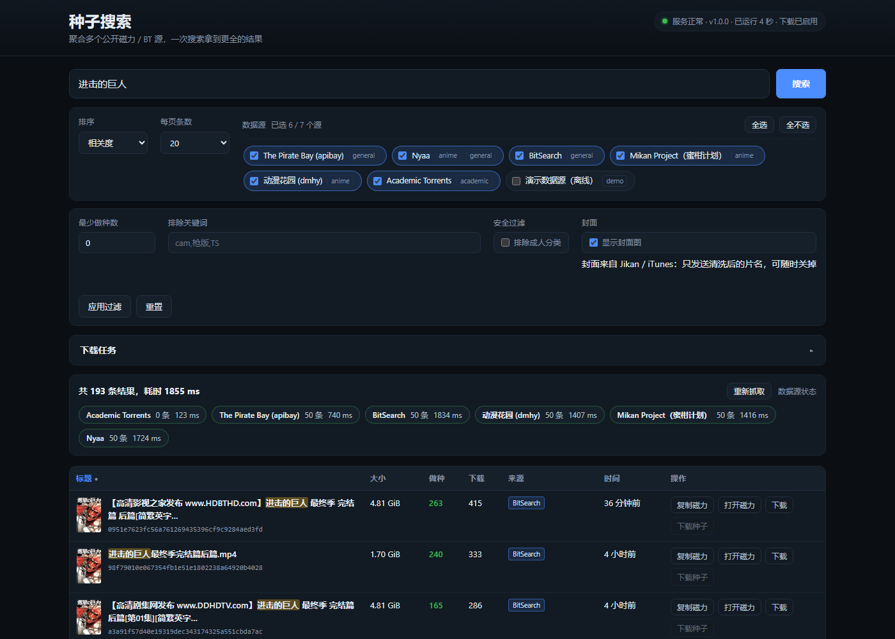
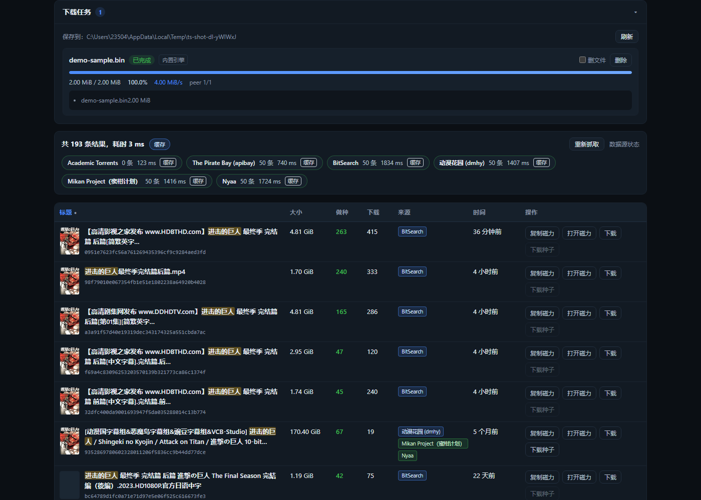

# Torrent Search

A **local search tool** that aggregates several public magnet/BitTorrent indexers — usable as a CLI, a web UI, or a JSON API. **Zero runtime dependencies** (Node built-ins only).

[中文文档](README.md) | **English**

```bash
node bin/magnet-search.mjs "ubuntu 24.04"
node bin/magnet-search.mjs serve          # then open http://127.0.0.1:8787
```



---

## Features

- **Multi-source aggregation** — one query hits 6 public sources concurrently; results are merged and de-duplicated (the same torrent from several sites appears once, with all sources listed).
- **Transparent failure handling** — a source timing out, being blocked, or changing its markup never breaks the others; per-source result counts, latency, and error reasons are all surfaced.
- **Result filtering** — minimum seeders, excluded keywords (`cam`/`TS`/…), and a safe filter (drops results the site itself tags as adult).
- **Controllable sorting** — relevance / seeders / leechers / size / date, each ascending or descending, applied to the whole candidate pool (not just the current page).
- **Zero dependencies** — no `npm install`, no build step. Node ≥ 20 runs it as-is.
- **Proxy support** — `--proxy 127.0.0.1:7897`, or `--proxy auto` (reads the system proxy; on Windows it reads the registry).
- **Three ways to use it** — CLI (pipeable, scriptable), web UI (visual), JSON API (callable from other programs).
- **Verifiable** — 287 offline tests (with real captured fixtures) + a live smoke test + a project self-check (`npm run lint`).

## Quick start

Requires Node.js ≥ 20 (developed and verified on Node 26.8.1).

```bash
# 1) Aggregate search
node bin/magnet-search.mjs "ubuntu 24.04"

# 2) Magnets only (handy for piping)
node bin/magnet-search.mjs "ubuntu 24.04" --magnet

# 3) Pick Chinese sources and sort
node bin/magnet-search.mjs "进击的巨人" -s mikan,dmhy --sort seeders

# 4) Start the web UI + API
node bin/magnet-search.mjs serve
```

## Command line

```
magnet-search <keywords> [options]   aggregate search
magnet-search serve [options]        start local web UI + JSON API (default 127.0.0.1:8787)
magnet-search sources                list all data sources
magnet-search check [keywords]       per-source connectivity self-check
magnet-search doctor                 diagnose the P2P download environment (run this first if downloads fail)
magnet-search download <target>      download a magnet / info hash (built-in BT engine, zero deps)
magnet-search downloads              show download task history
```

### Downloads failing? Run `doctor` first

```bash
node bin/magnet-search.mjs doctor
```

It checks each layer and prints an **actionable conclusion**: proxy TUN adapters, tracker announce (HTTP),
DHT (UDP), and a real BitTorrent handshake against actual peers. Example output behind a Clash TUN setup:

```
  ⚠ proxy TUN adapter   adapter "Meta" looks like a proxy TUN device
  ✓ tracker announce    50 peers returned (HTTP, can go through the proxy)
  ⚠ DHT (UDP)           network reachable but no peers found (UDP may be blocked)
  ✗ peer BT handshake   0 succeeded (5 closed by the remote peer)

Conclusion
  P2P traffic is being intercepted by the proxy (TUN mode owns the default route).
  Fix: switch Clash from TUN to "system proxy", or disable TUN temporarily;
  alternatively route BT traffic (high TCP ports and UDP) as DIRECT in your proxy rules.
```

When a download fails, the engine attaches the same kind of diagnosis automatically
(failure-mode summary + detected TUN adapter + suggestions).

### Downloading via qBittorrent (recommended on restricted networks)

If your network blocks P2P as above, the built-in engine (plaintext handshake) will not move,
but **qBittorrent ships protocol encryption (MSE)** which defeats many DPI setups. The tool has a
bridge: it hands the task to your local qBittorrent and tracks progress / cancellation itself.

```bash
# 1. Install and start qBittorrent (skip if already installed)
winget install qBittorrent.qBittorrent

# 2. Enable its Web UI: Tools → Options → Web UI
#    Tick "Web User Interface", set a username/password (port 8080 by default)

# 3. Point the tool at it (optional, defaults to http://127.0.0.1:8080)
export TORRENT_SEARCH_QBITTORRENT="http://127.0.0.1:8080|admin|your-password"

# 4. Download (--backend auto is the default: use qBittorrent when available)
node bin/magnet-search.mjs download "magnet:?xt=urn:btih:..." --backend auto
node bin/magnet-search.mjs download "ubuntu 24.04" --pick 1 --backend qbittorrent
node bin/magnet-search.mjs doctor        # tells you whether the bridge is usable
```

| Backend option | Meaning |
| --- | --- |
| `--backend auto` | **Default.** Uses qBittorrent when reachable, otherwise the built-in engine |
| `--backend builtin` | Built-in engine only (zero deps, plaintext handshake) |
| `--backend qbittorrent` | qBittorrent only (task fails with a clear reason when unreachable) |
| `--qb-url <url>` | Override the endpoint: `http://127.0.0.1:8080\|user\|password` |

The task list shows which backend handled each task (the web UI has a small
"built-in engine / qBittorrent" badge; `downloads` prints it too). Cancelling tells qBittorrent to
remove the task (keeping files); deleting honours your choice about the files.

> Measured note: on the machine this was developed on (Clash TUN + a commercial proxy),
> qBittorrent **also** got zero peers — the provider drops all BT traffic at the protocol layer,
> and encryption does not save it. **The only real fix is to let BT traffic go direct**
> (mark BT traffic as DIRECT in your proxy rules, or use a network that does not restrict P2P).

| Option | Meaning |
| --- | --- |
| `-s, --sources <list>` | Sources, comma separated; `default` = default set, `all` = everything; e.g. `apibay,nyaa` |
| `--sort <mode>` | `relevance` (default) / `seeders` / `leechers` / `size` / `date` |
| `--order <dir>` | `desc` (default) / `asc` |
| `-n, --page-size <N>` | Results per page (default 20, max 100) |
| `--page <N>` | Page number, starting at 1 |
| `--min-seeders <N>` | Keep only results with ≥ N seeders (unknown seeder counts are dropped) |
| `--exclude <words>` | Excluded keywords, comma separated; e.g. `--exclude cam,TS` |
| `--safe` | Safe filter: drop results the site tags as adult |
| `--json` | Emit full JSON (including per-source status) for scripting |
| `--magnet` | Emit magnet links only, one per line |
| `--timeout <ms>` | Per-source timeout (default 8000) |
| `--proxy <addr>` | HTTP proxy, e.g. `127.0.0.1:7897`; `auto` = detect the system proxy |
| `--demo` | Use only the built-in offline demo source (no network needed) |
| `--open` | (`serve`) open the browser after starting |
| `--no-color` / `-v` | Disable colours / verbose debug logging |

Filtering examples:

```bash
# Only results with ≥ 20 seeders, excluding cam/TS rips
node bin/magnet-search.mjs "blender open movie" --min-seeders 20 --exclude cam,TS

# Safe filter + ascending leechers (find obscure items)
node bin/magnet-search.mjs ubuntu --safe --sort leechers --order asc
```

**Exit codes**: `0` success (including "no results"), `1` runtime error or **all** sources failed, `2` bad arguments.

### Downloading

A **zero-dependency minimal BitTorrent engine** is built in (HTTP/UDP trackers, peer protocol,
BEP 9 metadata exchange, piece download with SHA1 verification), so search results can be downloaded directly:

```bash
# A magnet link
node bin/magnet-search.mjs download "magnet:?xt=urn:btih:...&dn=..."

# An info hash (40-char hex or 32-char Base32)
node bin/magnet-search.mjs download 2c6b6858d61da9543d4231a71db4b1c9264b0685

# Search first, download the 1st result
node bin/magnet-search.mjs download "ubuntu 24.04" --pick 1

# Size cap (stop when reached), custom dir, no extra public trackers
node bin/magnet-search.mjs download "magnet:?..." --max-size 500 --dir /tmp/dl --no-extra-trackers
```

| Download option | Meaning |
| --- | --- |
| `--pick <N>` | Search by keyword first and take the Nth result's magnet (1-based) |
| `--dir <path>` | Save directory, default `~/Downloads/torrent-search` |
| `--max-size <MiB>` | Size cap; stops when reached (marks the task `stopped`) |
| `--no-extra-trackers` | Trust only the magnet's own trackers (less exposure) |
| `--no-dht` | No DHT fallback: give up when trackers fail (faster, one path less) |
| `--limit-speed <rate>` | Rate limit, e.g. `2M` / `500K` / `1048576` (unlimited by default) |
| `--backend <name>` | `auto` (default) / `builtin` / `qbittorrent` — see above |
| `--qb-url <url>` | qBittorrent WebUI endpoint (`http://127.0.0.1:8080\|user\|password`) |

Every result in the web UI has a **Download** button, and the page has a downloads panel
(progress bar / speed / peers / cancel / delete) fed by SSE (`GET /api/downloads/stream`).



**Honest scope of the engine:**

- ✅ Supported: magnet parsing, HTTP(S)/UDP trackers, **DHT (BEP 5 iterative `get_peers`, as a tracker fallback)**,
  metadata exchange (BEP 9), multi-file torrents, per-piece SHA1 verification, resume (re-adding the same
  magnet verifies existing pieces first), a size cap as a safety valve.
- ❌ Not implemented: **DHT `announce_peer` and PEX**, seeding/uploading, protocol encryption, uTP. Therefore:
  - Peer discovery order is "magnet's own trackers → added public trackers → DHT fallback"; it only errors
    when all three fail (it never hangs silently).
  - **DHT is UDP and cannot traverse an HTTP proxy** — behind a proxy DHT will fail, so it is a
    "best-effort extra", never the only path; use `--no-dht` to skip it.
  - Throughput depends on peer count and is usually below mature clients such as qBittorrent/aria2.
  - For large files prefer a mature BT client; this feature targets small files and "search and grab" flows.

---

## Web UI

```bash
node bin/magnet-search.mjs serve            # http://127.0.0.1:8787
node bin/magnet-search.mjs serve --port 9000 --proxy auto
```

Interface: keyword search, multi-select sources (preference remembered), click-to-sort headers
(both directions), result filters (min seeders / excluded keywords / safe filter), pagination,
a per-source status bar (hover for failure reasons), keyword highlighting, one-click copy magnet /
open magnet / download `.torrent`, a "re-fetch" that bypasses the server cache, and a responsive
narrow-screen layout. It binds to the loopback address only — it is not exposed to the network.

### Cover images (poster + name)

Each result row carries a cover thumbnail; when there is no cover it shows the first character of the
title, so there is never an empty hole and nothing shifts while images load.

| Source | Covers | Notes |
| --- | --- | --- |
| [Kitsu](https://kitsu.io) | Anime | Needs a specific Accept header; weak on Simplified Chinese, so it falls through |
| [TVmaze](https://www.tvmaze.com) | TV shows | Detected from `S01E05`-style markers |
| [Wikipedia](https://www.wikipedia.org) | General fallback | Movies / books / games / manga; CJK titles use the zh site |

**About privacy**: covers require a third party, and the only usable key is the title. So only the
**cleaned title** is sent (`【…】进击的巨人 最终季 完结篇 后篇[简繁英字幕].Attack.on.Titan.S04…` → `进击的巨人`),
never the magnet, info hash or anything else about you. Image bytes are fetched and cached by the server,
so the browser only ever talks to its own origin.

Turn it off if you prefer:

- the "封面" switch in the UI (stored locally; when off, not a single request is made);
- or disable it server-wide: `node bin/magnet-search.mjs serve --no-covers`.

Matches are sanity-checked: fuzzy search really does turn `The Matrix` into `The Animatrix`, and
**a wrong cover is worse than none**, so a mismatch counts as a miss.

### Frontend performance

Rendering was tuned for large pages (100 rows/page) and can be measured with `npm run perf`:

```bash
npm run perf -- --url "http://127.0.0.1:8787/?q=ubuntu" --page-size 100
```

It uses CDP to collect script/style/layout time, long tasks and scroll frame rate, separating render
cost from network time. Current baseline (100 rows):

| Metric | Before | Now |
| --- | --- | --- |
| Long tasks (>50ms) | 1 (52ms) | **0** |
| Scroll frame rate | — | 16.2ms average / 0 dropped frames |
| Typing 8 characters | — | 0ms of rendering (no re-render) |

How: result rows are **inserted in chunks** (first chunk immediately, the rest across frames, avoiding the
one-shot 100-row layout stall), rows keep their node count low, and covers are looked up **only for rows
that enter the viewport**, applied progressively in small batches.

---

## JSON API

### `GET /api/search`

| Parameter | Required | Meaning |
| --- | --- | --- |
| `q` | ✅ | Keywords (max 200 chars) |
| `sources` | | Comma-separated source ids; omitted = default set |
| `sort` | | `relevance` (default) / `seeders` / `leechers` / `size` / `date` |
| `order` | | `desc` (default) / `asc` |
| `page` / `pageSize` | | Default 1 / 20, `pageSize` capped at 100 |
| `minSeeders` | | Keep results with ≥ this many seeders; unknown counts are dropped |
| `exclude` | | Excluded keywords, comma separated (max 20); ASCII words match at word starts, CJK matches substrings |
| `safe` | | `1` = drop results the site tags as adult |
| `noCache` | | `1` = skip the 60-second server-side result cache |
| `timeoutMs` | | Per-source timeout, default 8000 |

```jsonc
{
  "query": "ubuntu",
  "sort": "relevance",
  "order": "desc",
  "tookMs": 1234,
  "page": 1, "pageSize": 20,
  "total": 41,              // after filtering
  "totalBeforeFilter": 102, // after de-duplication, before filtering
  "totalPages": 3,
  "cached": false,
  "filters": { "minSeeders": 10, "exclude": ["cam"], "safe": true },
  "results": [
    {
      "id": "apibay:2c6b6858d61da9543d4231a71db4b1c9264b0685",
      "title": "Ubuntu 22.04 LTS",
      "infoHash": "2c6b6858d61da9543d4231a71db4b1c9264b0685",
      "magnet": "magnet:?xt=urn:btih:2c6b6858d61da9543d4231a71db4b1c9264b0685&dn=Ubuntu%2022.04%20LTS",
      "size": 3654957056, "sizeText": "3.40 GiB",
      "seeders": 31, "leechers": 1,
      "category": "Software",
      "adult": false,
      "publishedAt": "2022-05-18T14:33:51.000Z",
      "source": "apibay", "sourceName": "The Pirate Bay (apibay)",
      "detailsUrl": "https://thepiratebay.org/description.php?id=59191690",
      "torrentUrl": "https://apibay.org/torrent/59191690",
      "score": 42.7,
      "sources": ["apibay", "bitsearch"]
    }
  ],
  "sources": [
    { "id": "apibay", "name": "The Pirate Bay (apibay)", "ok": true, "count": 100, "tookMs": 420, "error": null, "cached": false },
    { "id": "nyaa", "name": "Nyaa", "ok": false, "count": 0, "tookMs": 8000, "error": "timeout (8000ms)", "cached": false }
  ]
}
```

> Fields a site does not provide are always `null` (e.g. dmhy has no size or seeder count) — never faked as `0`.
> `adult` relies solely on the site's own category tags, not on guessing from titles.

### Other endpoints

- `GET /api/sources` — source list (id, name, description, enabled by default)
- `GET /api/health` — `{ok, version, uptimeSec, node, proxy, downloads:{enabled, dir, active, backend}}`
- Download tasks (requires `serve`):
  - `POST /api/downloads` — body `{"input":"magnet or hash","dir"?,"name"?,"backend"?}` → 201 task snapshot
  - `GET /api/downloads` — task list (includes `dir`, `backend`, `qbit:{ok,version}`)
  - `GET /api/downloads/:id` — one task; `DELETE /api/downloads/:id?deleteFiles=1` — cancel and delete
  - `GET /api/downloads/stream` — SSE progress stream
- Progressive playback (`<video>` plays directly):
  - `GET /api/stream/<infoHash>` — file listing: `{infoHash, name, totalBytes, pieceLength, pieceCount,
    piecesDone, complete, files:[{index, path, length, contentType, url}]}`
  - `GET /api/stream/<infoHash>/<fileIndex>` — file bytes, supports `Range` (206 + `Content-Range`);
    200 without a `Range` header; `HEAD` returns headers only without waiting for data; out-of-range → 416
- Errors are uniform: `{"error":{"code":"bad_request","message":"..."}}`

#### How progressive playback works

Only **verified, on-disk** pieces are served — the file on disk is pre-allocated to the torrent's
length, so its size tells you nothing about validity; the only trustworthy source is the piece
bitmap (a piece is marked done only after its SHA1 check passes).

If the requested bytes have not arrived yet, the endpoint **waits** (30 seconds by default), so
"add a task and hit play" still works; on timeout it returns `503 data_not_ready` and the player
retries later.

Browsers often send `Range: bytes=0-` (the whole file). For an in-progress task the response is the
**currently contiguous ready range** (capped at 8 MiB per response) rather than the whole file, with
`Content-Range` reporting the actual range so the player can request the rest.

| Task state | Data source | Notes |
|---|---|---|
| Downloading | Engine session (verified pieces) | Progressive; waits when data has not arrived |
| Completed | Disk file stream | Reads the file by `Range`, lowest memory |
| qBittorrent backend (downloading) | — | Returns `409`: the data lives in qBittorrent, no piece bitmap available |
| qBittorrent backend (completed) | Disk file stream | Data already landed in the download dir; read by `Range` |
| Stopped/failed | — | Returns `409`: the piece bitmap was released with the session |

Known limitation: **for a multi-file torrent whose target file is not at the start, playback has to
wait for the preceding pieces**. The engine downloads pieces in ascending order (naturally sequential
for single-file torrents) and does not support "prioritise one file" yet\n
### Using it as a library

```js
import { createContext, searchAll } from './src/index.mjs';

const ctx = await createContext({ proxy: 'auto' });
const { results, sources } = await searchAll({ query: 'blender', sort: 'seeders', ...ctx });
console.log(results[0].magnet, sources);
```

### As an AI-agent skill

The repository ships a **DSH skill** (`skills/torrent-search/`) so an AI agent can search, pick a result,
start a download, and handle the "download won't move" case correctly:

```bash
npm run install-skill     # installs to ~/.dsh/skills/torrent-search (directory junction: edits apply live)
```

The wrapper calls the project modules **in-process** (no subprocess) and emits compact JSON.
`SKILL.md` encodes the hard-won rules: quote magnet links, treat downloads as long-running background
tasks, judge success by `status` rather than a progress bar, and read "peer handshake closed" as the
network blocking P2P rather than a tool defect.

---

## Data sources

| id | Site | Type | Default | Notes |
| --- | --- | --- | --- | --- |
| `apibay` | The Pirate Bay | General | ✅ | Official JSON API, up to 100 results per query |
| `nyaa` | Nyaa | Anime/general | ✅ | RSS, includes category and seeder counts (**no R18**) |
| `sukebei` | Sukebei (Nyaa's adult site) | Adult | ✅ | Same RSS API as nyaa; every result is tagged adult, so the safe filter drops them all at once |
| `bitsearch` | BitSearch | General | ✅ | DHT crawler index, JSON API, broad coverage |
| `mikan` | Mikan Project | Chinese anime | ✅ | RSS search; the episode number *is* the info hash |
| `dmhy` | DMHY (动漫花园) | Chinese anime | ✅ | RSS search; magnets are Base32 (normalised) |
| `academic` | Academic Torrents | Academic | ✅ | No search API: the full catalogue (~3 MB) is cached locally and queried |
| `demo` | Built-in offline data | Demo | ❌ | 10 fixed entries; works with no network |

> **Why `sukebei` exists**: nyaa.si itself carries no R18 content (the site split it onto a separate
> host), and apibay/bitsearch return at most 100 results per query each. Measured on the same keyword
> (「无码」): nyaa.si gave 6 results, sukebei gave 75 — without it such searches look like "far fewer
> results than before". Its results are all tagged adult, so the safe filter (or `--safe`) removes them
> in one go.

Adding a source means implementing one `search(query, ctx)` and registering it in
`src/sources/index.mjs` (~60 lines). See [CONTRIBUTING.md](CONTRIBUTING.md).

---

## Proxy

```bash
node bin/magnet-search.mjs "ubuntu" --proxy 127.0.0.1:7897   # explicit
node bin/magnet-search.mjs "ubuntu" --proxy auto             # detect (env vars → Windows registry)
```

Implementation: direct requests use Node's built-in `fetch`; proxied requests build an HTTP `CONNECT`
tunnel plus TLS by hand (Node's built-in fetch only reads proxy environment variables at process start,
so it cannot be switched at runtime).

---

## Docker deployment

> For a from-scratch server deployment (ports, firewall, tunnels, troubleshooting) see [docs/server-deploy.md](docs/server-deploy.md).

### Deploy (plain docker commands, no scripts)

> **Directory convention**: every command below runs in the **same deployment directory** — deploy and
> upgrade must use one directory. Examples use the clone directory `torrent-search` locally and
> `/opt/torrent-search` on a server (your own path is fine, but **pick one and stick to it**).
> `cd` back into it before upgrading.
>
> Why this matters: an earlier version had a trap where people kept rebuilding **old code** in an old
> directory while believing they were upgrading — it showed up as "my change didn't take effect".
> Inconsistent directories are what breeds that.


```bash
git clone https://github.com/XCool-603/torrent-search.git
cd torrent-search

# Build with your host UID/GID: a bind mount hides the image's ownership,
# so a mismatch means the container cannot write to ./downloads
APP_UID=$(id -u) APP_GID=$(id -g) docker compose up -d --build


docker compose ps                                  # status
docker compose logs -f                             # logs
docker compose exec torrent-search node bin/magnet-search.mjs doctor   # in-container diagnosis
```

Open <http://127.0.0.1:8787/>. It publishes to loopback only by default (there is **no authentication**).

**It also works without UID/GID** (the image default 10001), but then hand the download directory over:

```bash
sudo chown -R 10001:10001 ./downloads
```

### Upgrade

```bash
cd torrent-search
git pull

APP_UID=$(id -u) APP_GID=$(id -g) docker compose up -d --build

```

Downloaded files and unfinished tasks are unaffected (`./downloads` is a bind mount and the task
records live in `tasks.json` right there).

> ⚠️ **`docker compose build` does not pull new code** — always `git pull` first.
> The old `scripts/docker.sh deploy` did exactly that (build + up, never a pull), which is why it
> kept rebuilding stale code. That script and its Windows twin have been removed.

### Deploying to a server

```bash
# on the server
git clone https://github.com/XCool-603/torrent-search.git /opt/torrent-search
cd /opt/torrent-search
APP_UID=$(id -u) APP_GID=$(id -g) docker compose up -d --build

```

There is **no authentication**: anyone who can reach it can create download tasks (writing files into
the download directory). It binds to loopback by default; prefer an SSH tunnel:

```bash
ssh -N -L 8787:127.0.0.1:8787 user@your-server
# then open http://127.0.0.1:8787/ locally
```

To expose it on the LAN, set `TORRENT_SEARCH_BIND=0.0.0.0` in `.env` and open **both** doors:
the server firewall (`ufw allow 8787` or `firewall-cmd --add-port=8787/tcp`) **and** your cloud
provider's security group. With no authentication, put a reverse proxy with auth in front of it.

To route downloads through a VPN (P2P is often blocked on restricted networks), see the gluetun
example in the comments at the end of `docker-compose.yml`.


### Upgrading on a server

Same as locally: **go back to that directory first**, then pull and rebuild.

```bash
cd /opt/torrent-search          # ← the very directory you deployed in
git pull
APP_UID=$(id -u) APP_GID=$(id -g) docker compose up -d --build

curl -s http://127.0.0.1:8787/api/health     # should equal the version in package.json
```

The version in that health response is how you tell whether the update took: `1.0.0` means old code.


### Building the image and shipping it offline

The image name is fixed to **`docker-magnet-search`**, and it can be packed into a single file
(handy when the server has no internet access, or you would rather not build there):

```bash
# 1) build and tag (compose already declares the image name, so a plain build gives the same tag)
docker build -t docker-magnet-search .
# or
docker compose build

# 2) export to one file (tens of MB after gzip)
docker save docker-magnet-search | gzip > docker-magnet-search.tar.gz

# 3) on the server: import it (no rebuild, no network needed)
docker load -i docker-magnet-search.tar.gz
docker images docker-magnet-search          # confirm it landed
```

Run the imported image without rebuilding:

```bash
docker compose up -d --no-build
```

> `docker save` writes the whole image (all layers) and `docker load` restores it — no registry,
> no network.

### Exposing a port to the network (pick a free one)

By default it binds `127.0.0.1` only (the service has **no authentication** — anyone who can reach it
can create download tasks). To serve it externally, do three things — **first check the port is free**:

```bash
# is anything already listening there? (output means taken — pick another)
ss -lntp | grep -w 8787

# or let the kernel hand you a free one:
python3 -c 'import socket;s=socket.socket();s.bind(("",0));print(s.getsockname()[1]);s.close()'
```

Then put both settings in `.env`:

```ini
TORRENT_SEARCH_BIND=0.0.0.0
TORRENT_SEARCH_PORT=18787
```

```bash
docker compose up -d --force-recreate
ss -lntp | grep -w 18787      # expect 0.0.0.0:18787 or *:18787
```

**Then open both doors** (one is not enough):

```bash
# door 1: the server firewall
ufw allow 18787/tcp                                  # Debian/Ubuntu
firewall-cmd --add-port=18787/tcp --permanent && firewall-cmd --reload   # RHEL/CentOS
# door 2: your cloud provider's security group / firewall rules — allow TCP 18787
```

Verify from another machine:

```bash
curl -s http://<server-ip>:18787/api/health      # {"ok":true,"version":"1.3.2",...}
```

> ⚠️ Exposing it hands "create download tasks and write files into the download directory" to anyone
> who can reach the port. Think before opening it; prefer at least a reverse proxy with auth
> (Nginx/Caddy + basic auth), or just use an SSH tunnel:
> `ssh -N -L 18787:127.0.0.1:18787 user@server`.

### Configuration

> **Configuring the port** (highest priority first): the `--port 9000` flag → the
> `TORRENT_SEARCH_PORT=9000` environment variable → `.env` in the project root
> (`TORRENT_SEARCH_PORT=9000`).
> `.env` is read by **local runs too**, matching `docker compose` behaviour; real environment
> variables win, so ad-hoc overrides still work:
> `TORRENT_SEARCH_PORT=9000 node bin/magnet-search.mjs serve`.


Everything tunable lives in `.env` (created from `.env.example`):

| Variable | Default | Meaning |
| --- | --- | --- |
| `TORRENT_SEARCH_PORT` | `8787` | Host port |
| `TORRENT_SEARCH_DOWNLOADS` | `./downloads` | Host directory for downloads (e.g. `/volume1/downloads` on a NAS) |
| `TORRENT_SEARCH_BACKEND` | `auto` | `auto` / `builtin` / `qbittorrent` |
| `TORRENT_SEARCH_QBITTORRENT` | `http://host.docker.internal:8080` | qBittorrent WebUI on the host |
| `HTTPS_PROXY` / `HTTP_PROXY` | empty | Route search requests through a host proxy (P2P is TCP/UDP; a proxy does not help it) |

Inside the container (already set by the image):

| Variable | Default (native / container) | Meaning |
| --- | --- | --- |
| `TORRENT_SEARCH_HOST` | `127.0.0.1` / `0.0.0.0` | Bind address. In a container it must be `0.0.0.0` or port mapping cannot reach it |
| `TORRENT_SEARCH_PORT` | `8787` | Listen port |
| `TORRENT_SEARCH_DOWNLOAD_DIR` | `~/Downloads/torrent-search` / `/downloads` | Download directory |
| `TORRENT_SEARCH_CACHE` | user cache dir | Disk cache (the academic catalogue) |

Diagnostics inside the container:

```bash
docker compose exec torrent-search node bin/magnet-search.mjs doctor
```

> **Download directory permissions on Linux / NAS**: the container runs as non-root while a bind
> mount takes its ownership from the host — a UID mismatch means permission errors (`docker compose up`
> will also create a missing `./downloads` as root). Pass your host IDs at build time
> (`build.args` in `docker-compose.yml` already wires them up):
>
> ```bash
> mkdir -p downloads
> APP_UID=$(id -u) APP_GID=$(id -g) docker compose up -d --build
> ```
>
> The names are `APP_UID`/`APP_GID`, not `UID`/`GID`: **`UID` is a readonly shell variable in bash**,
> so `UID=$(id -u) ...` fails with `UID: readonly variable`.
> Building without them works too (image default 10001) — then run
> `sudo chown -R 10001:10001 ./downloads`.
> Docker Desktop bind mounts (Windows/macOS) are permissive, so this needs no action.

### Three honest notes about containerising

**1. Docker does not bypass the blocking.** On Windows, Docker Desktop runs containers inside a WSL2 VM,
and their traffic still leaves through the host network stack — **Clash TUN can still capture it**.
The blocking also happens at the proxy provider's egress, independent of where the client runs.

**2. It adds things you must handle** (all handled by the image and code above): files need a volume,
the server must bind `0.0.0.0`, qBittorrent must be reached via `host.docker.internal`, and `doctor`
cannot see the host's TUN device from inside a container (it says so explicitly instead of guessing).

**3. The two cases where it genuinely pays off:**

- **Deploying to a Linux NAS / home server** for always-on use with access from other devices;
- **Pairing with a VPN container** so BT traffic takes a clean egress — see the commented example at the
  end of `docker-compose.yml` (`network_mode: service:gluetun`). Container traffic leaves through the VPN,
  unaffected by the host's Clash TUN, and VPN providers usually do not block P2P.

> Conversely: if your goal is just "download on this Windows machine", **running Node natively is simpler** —
> the project has zero dependencies, so `node bin/magnet-search.mjs serve` is all it takes.

---

## Tests

```bash
npm test           # 287 offline tests: parsing, aggregation, filtering, cache, HTTP, server, BT engine, download manager
npm run lint       # project self-check: full syntax check + conventions (zero deps / no XSS APIs / adapter contracts)
npm run smoke      # live smoke test: real requests to every online source, verifying field consistency
npm run screenshots # regenerate the Web UI screenshots in the README (headless Edge/Chrome, zero deps)
npm run fixtures   # re-capture test fixtures (run after a site redesign)
npm run check      # per-source connectivity self-check
```

Layers: pure functions → parsing (real fixtures) → aggregation (injected fake sources covering
filtering/cache/sorting) → network (local HTTP + a self-hosted CONNECT proxy) → BT engine
(**a local fake swarm**: a self-implemented tracker and seeding peer, verifying magnet → metadata →
pieces → verification → files on disk end to end) → server (a real HTTP server covering validation and
status codes) → live smoke test (the only layer that needs the internet).

CI (`.github/workflows/ci.yml`) runs the unit tests on Node 20/22/24 across Ubuntu and Windows;
the live smoke test runs as a separate non-blocking job (GitHub's cloud IPs get HTTP 403 from some sources).

---

## Project layout

```
bin/magnet-search.mjs   CLI entry point (search + download)
src/
  ├── aggregate / server / http / cache / models / magnet / size / format / xml / rss / categories
  ├── bt/               minimal BT engine (bencode, tracker, peer, torrent, storage, engine)
  ├── download/         task manager (queueing, concurrency, progress events, persistence, qBittorrent bridge)
  └── env.mjs           runtime environment adaptation (native vs container defaults)
web/                    web UI (plain HTML/CSS/JS, no build step, includes the downloads panel)
test/                   offline tests + real response fixtures + a local fake swarm
tools/                  fixture capture, live smoke test, project lint, screenshot generator
docs/                   requirements, source research, architecture and design decisions (Chinese)
.github/workflows/      CI
```

---

## Disclaimer

This tool only aggregates metadata that is already public on **public index sites** (titles, sizes,
info hashes, …). It does not host, cache, or distribute any copyrighted content. The built-in download
feature is standard BitTorrent client functionality; the tool itself provides and indexes no content.
Comply with the laws of your jurisdiction and with each site's terms of service, and use this tool only
for content you are entitled to obtain (for example open-source distributions or CC-licensed works).
